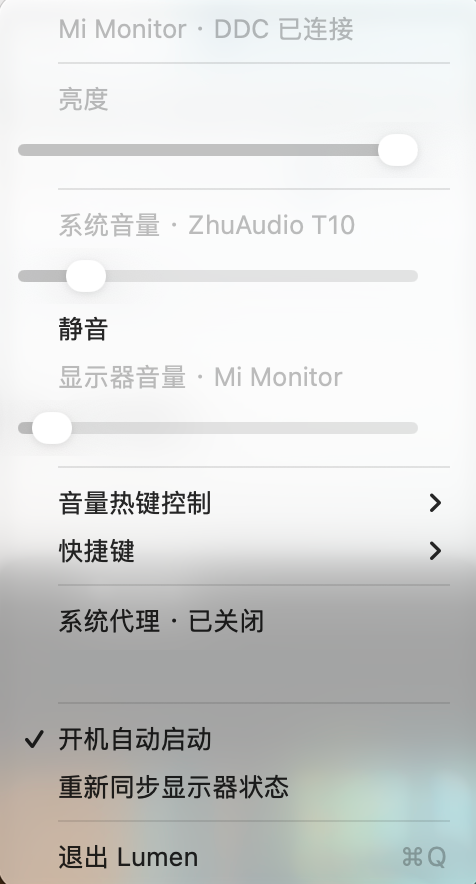
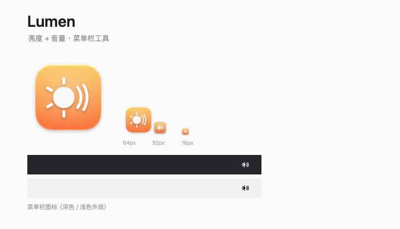

# Lumen


**让 Mac mini 的键盘，重新管住外接显示器：亮度、音量、静音，顺手还有代理开关。**



<sub>菜单栏点开的控制面板：外接屏亮度、系统音量、显示器音量、静音、代理开关，都在一屏里。</sub>

屏幕太亮，按下 `⇧F2`；想把声音关掉，按下 `⇧F4`。屏幕上浮出一条进度提示，手不用离开键盘，也不用伸手去摸显示器背后的按钮。

Lumen 就是为这件事写的：一台没有内置屏的 Mac，配上一台第三方显示器，键盘上的媒体键也能像在 MacBook 上一样好用。

## 它解决什么问题

**Mac mini / Mac Studio 配第三方显示器，亮度键形同虚设。** 这类主机没有内置屏，而系统自带的亮度控制通常只对内置屏和苹果自家显示器生效：键盘上的 F1/F2 按下去，外接屏往往没什么反应，想调暗只能去按显示器背面的实体按钮，或者翻显示器 OSD。Lumen 补上这条通道——直接和显示器对话（DDC/CI），动的是显示器自己的亮度值，效果跟按显示器按钮是一回事，但键在手上。

**音量键只管系统音量，管不到显示器音箱。** 声音从显示器自带音箱出来时，键盘上的 F5/F6 调的是系统输出设备，听感上往往没什么变化。Lumen 把显示器音量也接上，并且允许同一组音量热键在「系统」和「显示器」之间一键切换。

**很多同类工具靠遮罩假装变暗。** 在画面上盖一层半透明遮罩也能看起来变暗，但对比度和色彩跟着变差，截图和录屏也会一并变暗。Lumen 改的是显示器硬件亮度。

**代理要开三次开关？** 系统设置里 HTTP、HTTPS、SOCKS 是三个独立开关，只开一半的流量最难受，也最难查。Lumen 把它们当成一个开关，要么全开，要么全关。

**不想为调个亮度装一堆东西？** 不用 Electron，不用 Python，不装后台服务，也不需要额外授权。体积比一张照片还小，常驻内存大概 20 MB。

## 功能一览

| | |
|---|---|
| **外接屏亮度** | 用 F1/F2 调第三方显示器的真实亮度，不用再去按显示器按钮 |
| **两套音量** | 系统输出音量 + 显示器音箱音量，热键可随时切换目标 |
| **静音** | 一个键开关系统静音，状态在菜单里同步显示 |
| **系统代理** | 一键切换 HTTP / HTTPS / SOCKS，当前服务器地址直接显示在菜单里 |
| **屏幕提示** | 按键后浮出进度条，不抢焦点，全屏和多个桌面下都能看到 |
| **可自定义** | 快捷键、步长、音量目标都写在配置文件里，改完立即生效 |
| **开机自启** | 菜单里勾选即可，重启后接着用 |
| **不打扰的外观** | 菜单栏图标跟随系统浅色 / 深色外观自动上色 |

## 快捷键

| 操作 | 默认快捷键 |
|---|---|
| 亮度 + | `⇧F1` |
| 亮度 − | `⇧F2` |
| 静音开关 | `⇧F4` |
| 音量 − | `⇧F5` |
| 音量 + | `⇧F6` |
| 打开控制面板 | `⇧F11` |

F1–F6 正好对应 Mac 传统媒体键的位置（F1/F2 亮度、F4 静音、F5/F6 音量），加上 ⇧ 之后系统不会把它当媒体键处理，位置依旧顺手。选 ⇧ 还有一个好处：`⌘F5` 是旁白开关、`⌥⌘F5` 是辅助功能快捷键、`⌥⌘F8` 是缩放，⇧ 系列不会和这些系统组合冲突，也不会挤占旁白用户的键位。

不习惯？全部可以改。

## 点开菜单

点击菜单栏图标，或按 `⇧F11`：

- **亮度滑块** — 随手拖，松开即生效
- **系统音量滑块** + **静音 / 取消静音**
- **显示器音量滑块** — 针对显示器自带音箱
- **音量热键控制** — 音量热键走系统还是走显示器
- **系统代理** — 一键开关，下面一行显示服务器地址和已启用的协议（示意图中已隐去）
- **快捷键** — 查看当前绑定、打开配置文件、重新载入、恢复默认
- **开机自动启动**
- **重新同步显示器状态** — 热插拔或唤醒后用一下

## 上手

### 下载 dmg

到 [Releases](https://github.com/cn-vhql/lumen/releases) 下载最新的 `Lumen-x.y.z.dmg`，打开后把 Lumen 拖进「应用程序」即可。dmg 由 GitHub Actions 在推 tag 时自动构建，内含 Apple Silicon 与 Intel 两套架构。

因为项目没有付费开发者账号，app 是 ad-hoc 签名、没有走苹果公证，首次打开会被 Gatekeeper 拦下。右键点图标选「打开」，或者执行一次：

```bash
xattr -dr com.apple.quarantine /Applications/Lumen.app
```

### 从源码构建

不放心二进制就自己编（需要 Xcode Command Line Tools，不用安装完整 Xcode）：

```bash
xcode-select --install
./build.sh
cp -R build/Lumen.app /Applications/
open /Applications/Lumen.app
```

`./build.sh` 默认分别编译 arm64 与 x86_64 再合成通用二进制，只想要单架构可以 `LUMEN_ARCHS=arm64 ./build.sh`；`./make-dmg.sh` 会多走一步，在 `build/` 下产出可发布的 dmg。

菜单栏出现橘色太阳图标就说明成功了。配置文件会在首次启动时自动生成；想让它在登录时启动，勾选菜单里的「开机自动启动」。

系统要求：macOS 13 或更新，以及一台支持 DDC/CI 的外接显示器（DisplayPort、HDMI 或经 USB‑C 转接）。

## 改快捷键

配置文件在 `~/Library/Application Support/Lumen/config.json`，菜单「快捷键 → 打开配置文件…」可以直接定位。里面能改这几件事：

- 每个动作绑定的键和修饰键（⇧ / ⌃ / ⌥ / ⌘ 可自由组合）
- 每次按键的步长
- 音量热键控制系统还是显示器

改完点「快捷键 → 重新载入配置」立刻生效，不用重启。完整的键码表和字段说明见 [技术说明](docs/technical-notes.md#配置文件)。

## 常见问题

**按了没反应？** 现在按快捷键如果没有通达显示器，屏幕上会直接提示「显示器未连接 · 无 DDC 响应」，而不是照常弹出亮度条。看到这个提示时依次检查：显示器是否开机并在当前输入源、OSD 里是否打开了 DDC/CI（有些型号默认关闭）、线材是否为支持 DDC 的 DP / HDMI 直连（部分转接坞不透传 DDC）。之后点一次菜单里的「重新同步显示器状态」，它会丢弃旧连接重新握手。

想看更细的原因，可以用 `LUMEN_DEBUG=1 open -a Lumen` 启动，DDC 的每次打开、读写返回码、重连与校验结果都会写进 `~/Library/Application Support/Lumen/debug.log`。

少数显示器只开放了亮度以外的 VCP 指令，那种情况下亮度可以调、显示器音量可能调不到。

**快捷键被别的软件占了？** 菜单「快捷键」子菜单里对应条目会标出「⚠︎ 占用」，换成别的组合或改配置文件即可。

**MacBook 的内置屏也能调吗？** 目前主要面向「无内置屏主机 + 外接显示器」这个组合：亮度通道走的是显示器的 DDC/CI，内置屏不在覆盖范围内。

**能在多台显示器上分别调亮度吗？** 目前取第一台应答 DDC 的外接屏。

**能用 Fn 组合键吗？** 很多外接键盘的 Fn 不会上报给 macOS，所以 Fn 组合做不了，请用 ⇧ / ⌃ / ⌥ / ⌘。

**会联网、需要订阅或授权吗？** 不需要。没有网络请求，不读屏幕内容，不监听键盘输入，除了切换代理时不改任何系统设置。

## 更多

- [技术说明](docs/technical-notes.md) — 实现方式、设计取舍、配置文件字段、构建细节、已知限制
- [图标脚本](tools/make-icons.swift) — 应用图标与菜单栏图标由代码生成，可自行改色重绘



<sub>左：应用图标在各尺寸下的渲染；右：菜单栏图标在深色 / 浅色外观下的表现。</sub>

## 许可

本项目基于 [Apache License 2.0](LICENSE) 发布：可自由使用、修改和再分发，包括商业用途；再分发时请保留 [LICENSE](LICENSE)（以及 `NOTICE`，如项目后续添加）并说明你做了哪些修改。
